# Chrysos Heirs — an Omarchy theme

A [Honkai: Star Rail](https://hsr.hoyoverse.com/) theme for [Omarchy](https://omarchy.org/), built around the fourteen **Chrysos Heirs** of Amphoreus.

**One theme, fourteen palettes.** Change your wallpaper and your whole desktop changes with it. The terminal, window borders, bar, btop, Neovim, icons and lock screen all switch to the colours of the heir on screen.

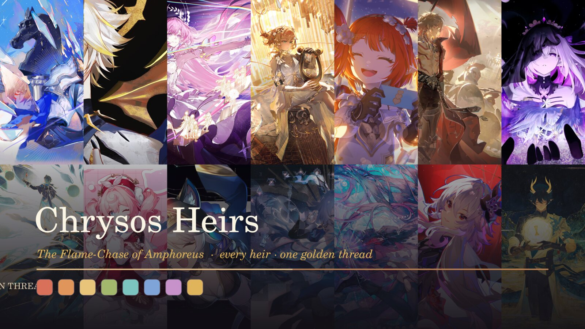

---

## What makes it special

- 🎨 **Colours taken from the art.** Each palette was sampled straight from its wallpaper, then adjusted only as much as needed to keep terminal text readable.
- 🔗 **Bonds you can see.** The border around your focused window is a gradient running from the heir's own colour into the colour of the person they're bound to. Mydei's crimson fades into Castorice's violet, and Phainon's azure into Cyrene's rose.
- 🔒 **A Star Rail lock screen.** It shows the wallpaper sharp, the HSR logo glowing in the heir's colour, a serif clock, and the heir's name and bond.
- 🧼 **Leaves your setup alone.** It doesn't touch your keybindings, gaps, fonts or config files. Omarchy builds every app's colours from one `colors.toml`, the way it does for its own themes.

| Lock screen (Castorice) | Lock screen (Hyacine, light theme) |
|---|---|
| 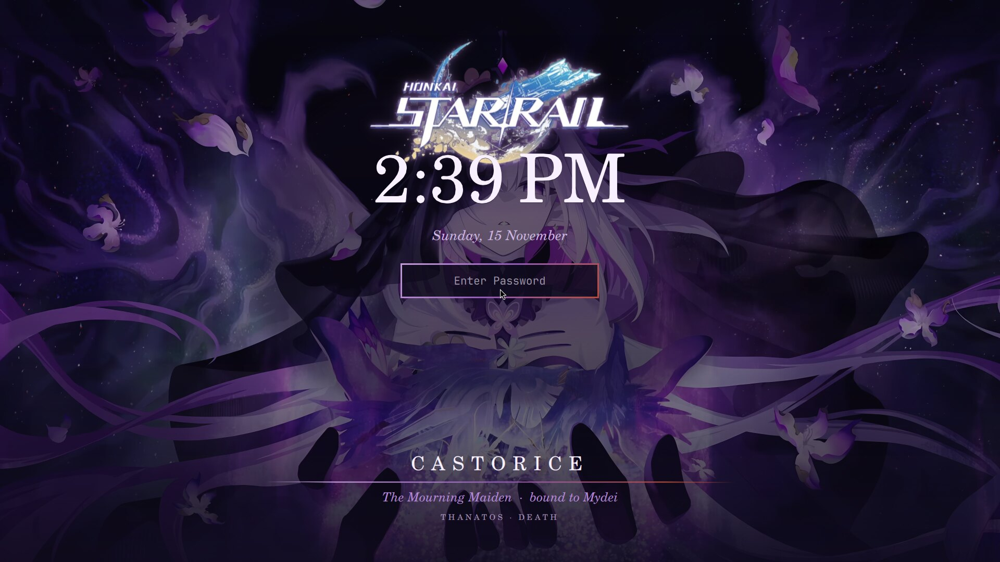 | 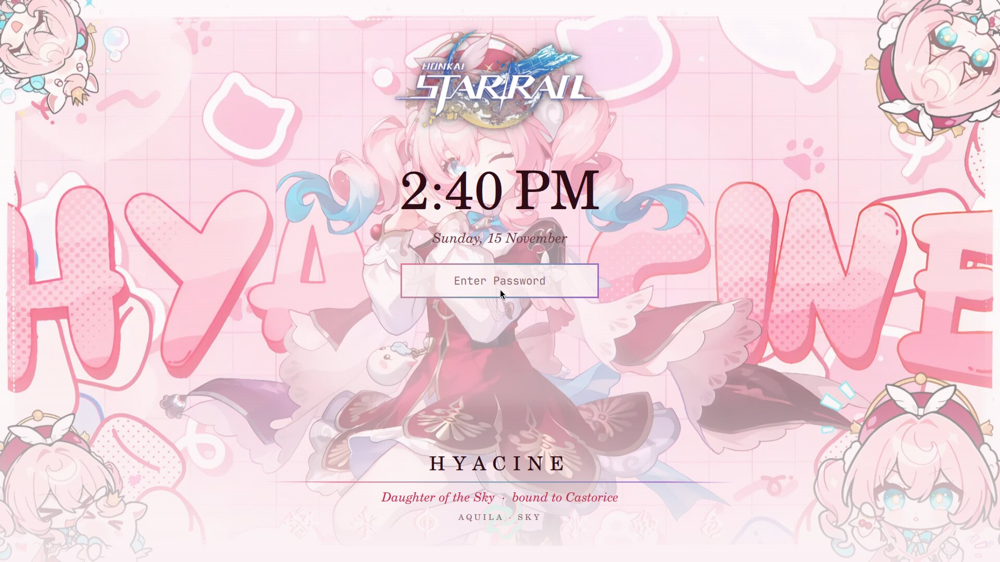 |

---

## Install

You need a working Omarchy system and `inotify-tools`:

```bash
omarchy pkg add inotify-tools
git clone https://github.com/Jitheswar/chrysos-heirs.git
cd chrysos-heirs
./install.sh          # theme + wallpaper watcher
omarchy theme set "Chrysos Heirs"
```

Want the HSR lock screen too? Run this instead of plain `./install.sh`:

```bash
./install.sh --lock
```

### Use it

Switch wallpapers the usual Omarchy way, with your background shortcut, the background picker or `omarchy theme bg next`. The palette follows within a second or two.

### Uninstall

```bash
./install.sh --uninstall
```

This removes the theme, the watcher service and the lock-screen copy, and switches you back to a stock theme.

---

## The heirs and their bonds

| | Heir | Title | Bound to | Why |
|---|---|---|---|---|
| 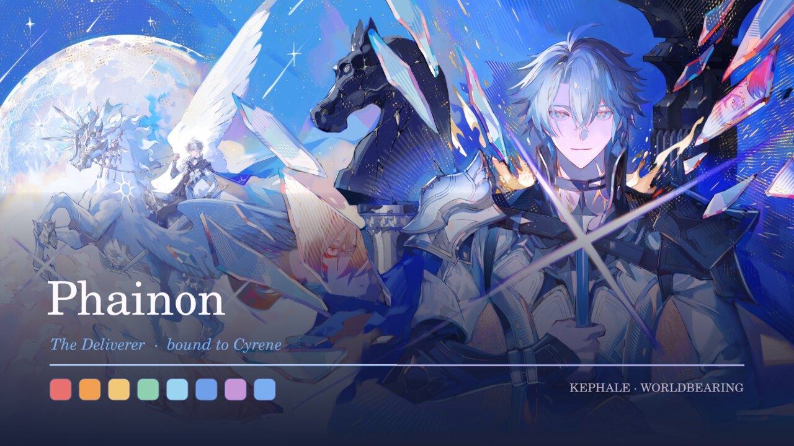 | **Phainon** | The Deliverer | Cyrene | She walked beside him through every return of the cycle |
| 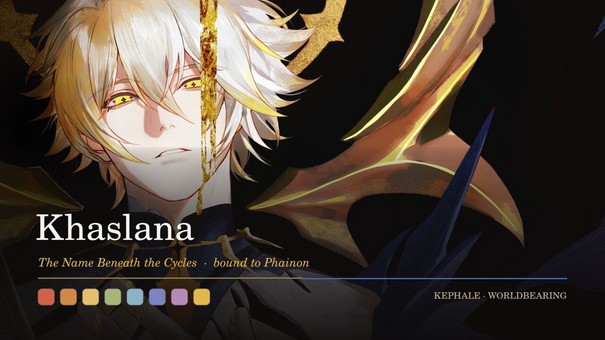 | **Khaslana** | The Name Beneath the Cycles | Phainon | The self he was before the loops wore him down |
| 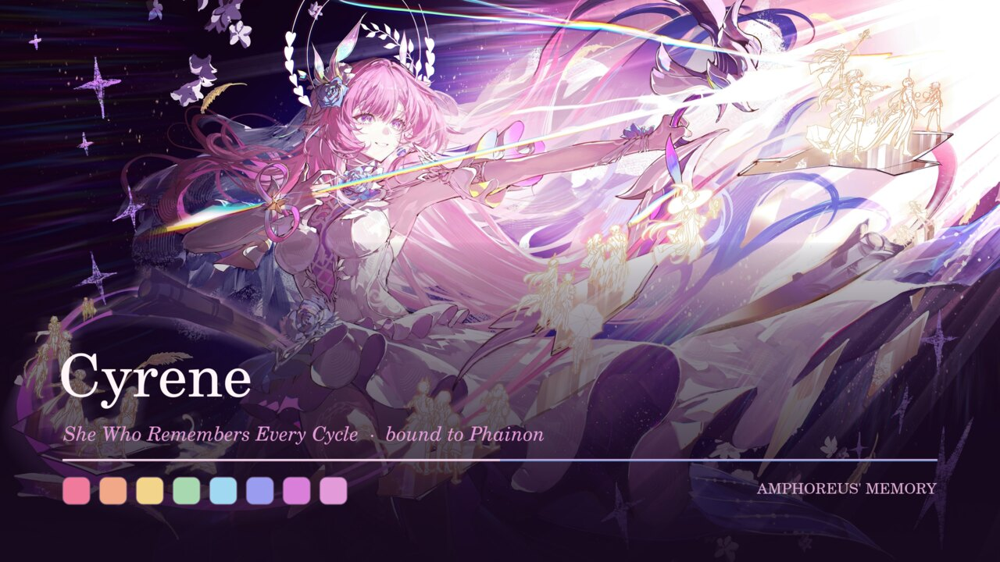 | **Cyrene** | She Who Remembers Every Cycle | Phainon | The one she carried through every loop |
| 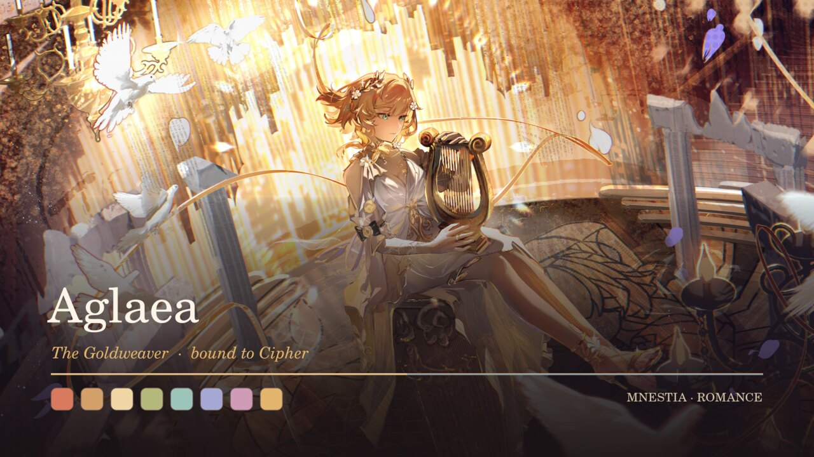 | **Aglaea** | The Goldweaver | Cipher | Her golden thread, sent out into the dark |
| 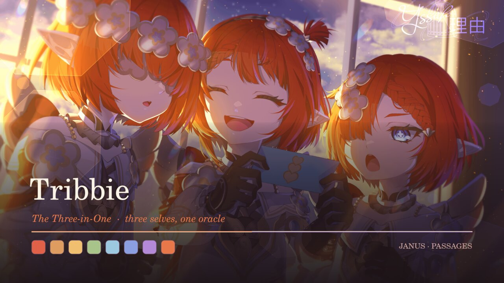 | **Tribbie** | The Three-in-One | herself ×3 | Trinnon, Tribios, Trianne: three colours, one oracle |
| 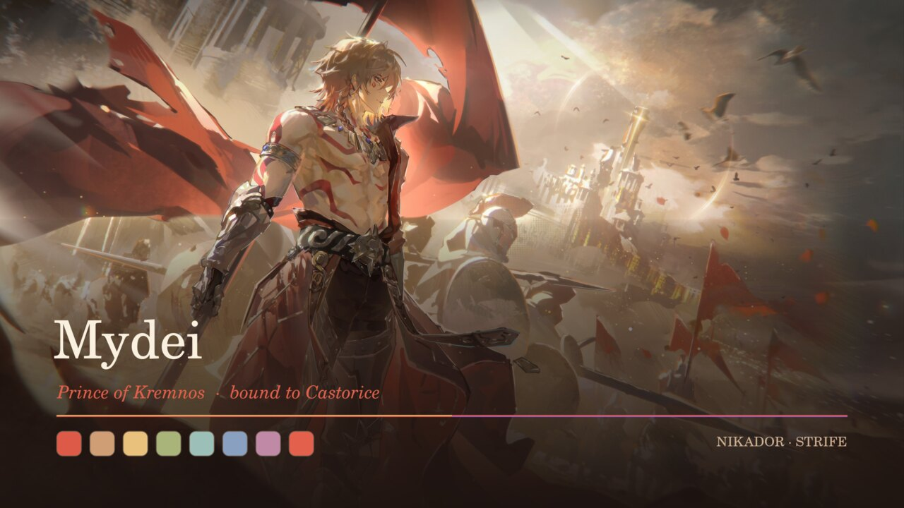 | **Mydei** | Prince of Kremnos | Castorice | Death can't take him, so her touch is safe with him |
| 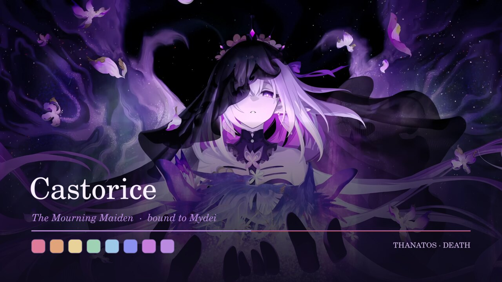 | **Castorice** | The Mourning Maiden | Mydei | The only one she can hold |
| 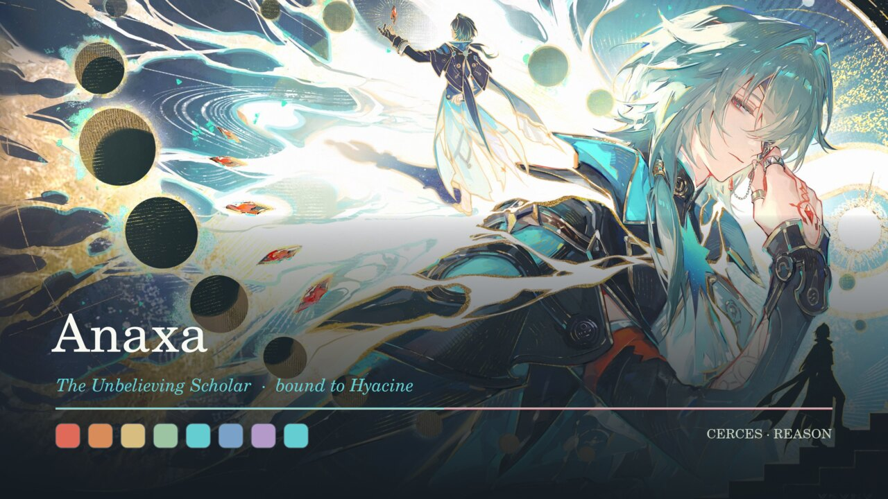 | **Anaxa** | The Unbelieving Scholar | Hyacine | Grove of Epiphany: reason and remedy |
| 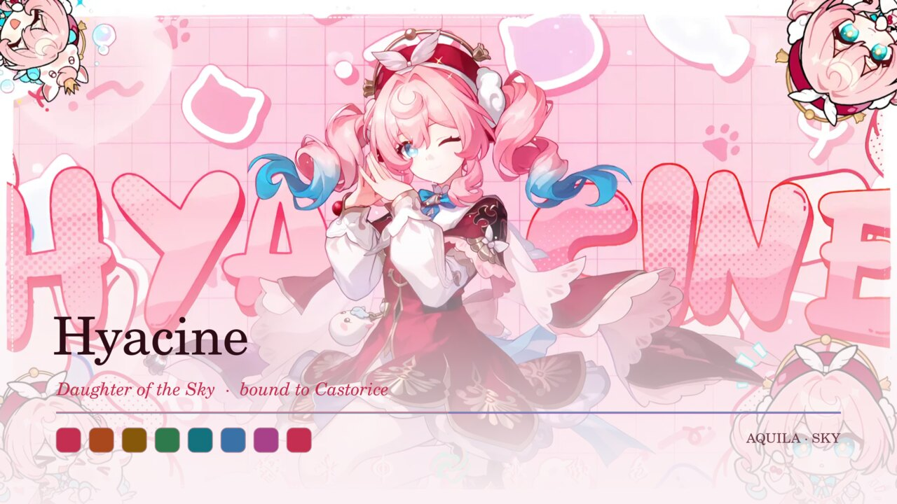 | **Hyacine** | Daughter of the Sky | Castorice | The healer and the girl whose touch is death, friends anyway (light theme) |
| 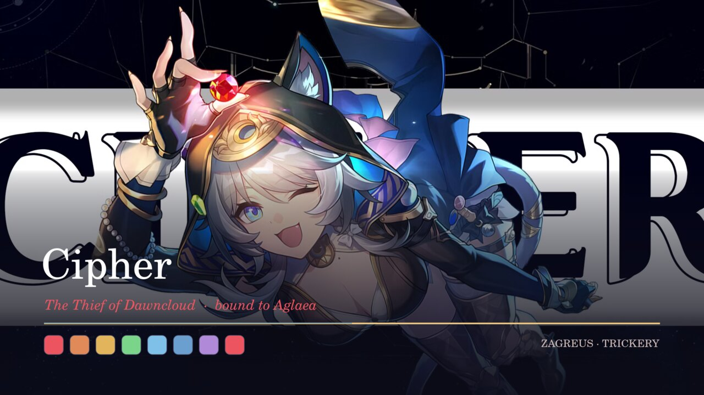 | **Cipher** | The Thief of Dawncloud | Aglaea | A thief working Aglaea's threads |
| 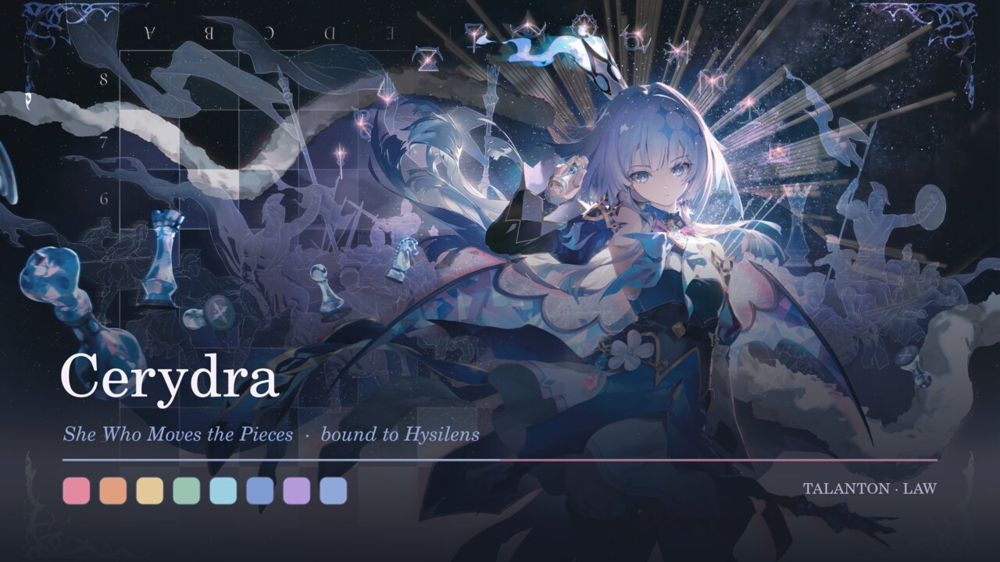 | **Cerydra** | She Who Moves the Pieces | Hysilens | Her friend, and in some cycles her assassin |
| 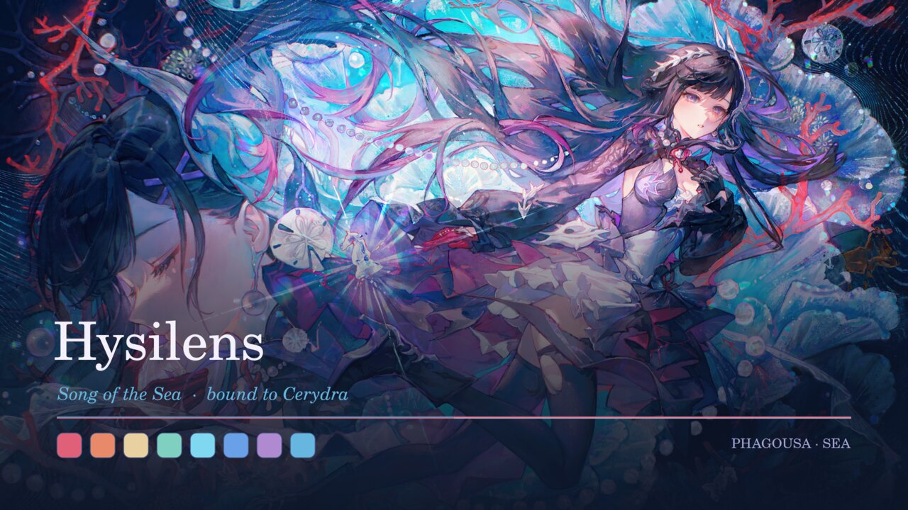 | **Hysilens** | Song of the Sea | Cerydra | Kept her secrets, and in some cycles ended her |
| 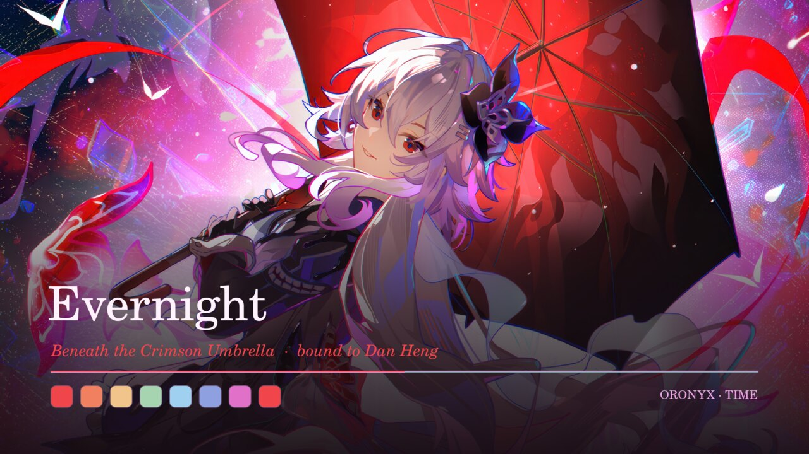 | **Evernight** | Beneath the Crimson Umbrella | Dan Heng | March 7th's reflection and her oldest companion |
| 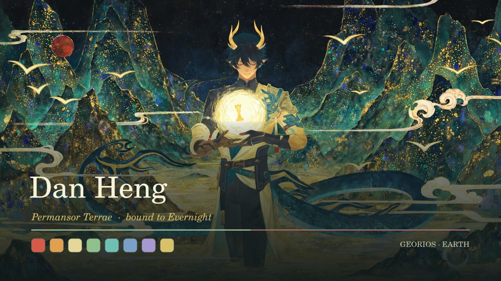 | **Dan Heng** | Permansor Terrae | Evernight | The red moon in his sky is her umbrella's red |

---

## How it works (for the curious)

```
~/.config/omarchy/themes/chrysos-heirs/
├── backgrounds/        01-phainon.jpg … 14-dan-heng.jpg
├── heirs/<heir>/       colors.toml, chrysos-lock.json, icons.theme
├── colors.toml         ← copy of the heir currently on screen
└── bin/                chrysos-heirs-sync, chrysos-heirs-watch
```

1. A small systemd user service (`chrysos-heirs-sync`) watches Omarchy's `current/background` link.
2. When the wallpaper changes, it copies that heir's palette into the theme and re-applies it with `OMARCHY_THEME_SKIP_BACKGROUND=1`, so the wallpaper stays where you put it.
3. It does nothing unless **Chrysos Heirs** is your active theme, and nothing for a wallpaper that isn't one of the fourteen (for example, one you add yourself).

**The lock screen** is the one part that lives outside the theme folder. Omarchy's lock is a shell plugin, so `--lock` makes a copy of it and adds one file, `lock/ChrysosOverlay.qml`. The overlay only draws when the active theme ships `chrysos-lock.json`. On any other theme your lock looks exactly like stock. Because it's a copy, it won't receive Omarchy's future lock-screen updates. If an update ever breaks it, run `./install.sh --uninstall` and then plain `./install.sh`.

### Change a palette

Every colour and bond is in [`build.py`](build.py). Edit the heir you want, then run `./install.sh` again.

---

## Credits

- **Wallpapers:** the art belongs to its original artists. Their signatures and watermarks are left intact in the images. This is a non-commercial fan project. **If you made one of these pieces and want it removed, please open an issue and it will be taken down right away.**
- **Honkai: Star Rail** and its logo and characters are trademarks of **HoYoverse / COGNOSPHERE**. This project is not affiliated with or endorsed by them.
- **[Omarchy](https://omarchy.org/)**: the theme system this plugs into.

The code (everything except `wallpapers/` and `assets/`) is MIT-licensed. See [LICENSE](LICENSE).
